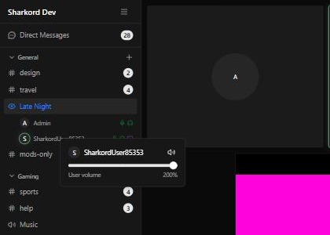

# GainShark

Sharkord plugin that raises the volume limit for users, screen shares and plugin streams from 100% to 200%.



## How it works

Sharkord's volume sliders stop at 100%, because `<audio>` elements cannot play louder. GainShark extends the existing sliders to 0–200%:

| Where | Slider |
| --- | --- |
| Right-click a user in a voice channel | Voice |
| Volume button on a user's card | Voice |
| Volume button on a screen share | Screen share audio |
| Volume list in the top bar | All voices, screen shares and streams |

The line in the middle of a slider marks 100%. Up to 100% the slider sets Sharkord's own volume. Above 100% Sharkord stays at 100% and GainShark routes the audio through a Web Audio gain node with an optional limiter. Sources at or below 100% are not touched.

Values above 100% are stored per browser. Sharkord's own volume settings never exceed 100%, so removing the plugin leaves valid settings behind.


## Installation

Requires a Sharkord server with plugin SDK version 2.

1. Download `gainshark-<version>.zip` from [Releases](../../releases).
2. Extract it into the `plugins` folder of the Sharkord data directory, so the result is `plugins/gainshark/manifest.json`. On a default install the folder is `~/.config/sharkord/plugins`.
3. Server settings → General: enable **Plugins**.
4. Server settings → Plugins: enable **GainShark**.

To update, replace the `gainshark` folder and toggle the plugin off and on. Volume settings are kept.

## Building

The Sharkord plugin SDK is not on npm yet, so it is linked from local clones.

```bash
git clone https://github.com/Sharkord/sharkord.git
cd sharkord && bun install && cd packages/plugin-sdk && bun link && cd ../../..
git clone https://github.com/Sharkord/plugin-builder.git
cd plugin-builder && bun install && bun link && cd ..
```

Then in this repository:

```bash
bun install
bun link @sharkord/plugin-sdk
bun link @sharkord/plugin-builder
bun run build
```

The plugin is written to `dist/gainshark/`. Set `SHARKORD_PLUGINS_PATH` in `.env` (see `.env.example`) to copy it into a server's plugins folder on every build.

## Limitations

- GainShark relies on Sharkord client internals: the `data-user-id` and `data-stream-id` attributes of audio elements, the slider markup and React component props. If a Sharkord update changes them, the sliders fall back to Sharkord's own 0–100% and audio plays normally.
- Choosing an output device for boosted audio needs `AudioContext.setSinkId` (Chromium 110+, Electron). Other browsers play boosted audio on the default device.
- Boosting can clip loud sources. The limiter is on by default.

## License

[MIT](LICENSE)

Parts of this project were created with AI assistance.
