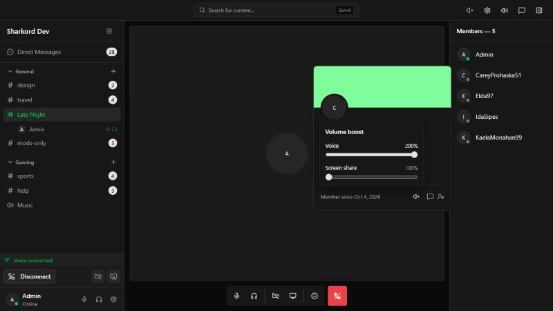
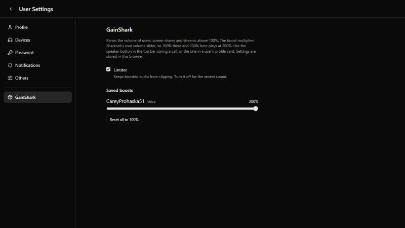

# GainShark

Sharkord plugin that raises the volume limit for users, screen shares and plugin streams from 100% to 200%.



## How it works

Sharkord plays remote audio through `<audio>` elements, whose volume is capped at 100%. GainShark adds a boost of 100–200% on top of Sharkord's own volume slider. Boosted sources are routed through a Web Audio gain node and an optional limiter. Sources without a boost are not touched.

Effective volume = Sharkord volume × boost. Example: 100% in Sharkord and 200% in GainShark plays at 200%.

| Where | Controls |
| --- | --- |
| Top bar, speaker button (during a call) | Every voice, screen share and stream in the channel |
| User card, speaker button | Voice and screen share of that user |
| User settings → GainShark | Limiter, saved boosts, reset |

Boosts are stored per browser, like Sharkord's own volume settings.



## Installation

Requires a Sharkord server with plugin SDK version 2.

1. Download `gainshark-<version>.zip` from [Releases](../../releases).
2. Extract it into the `plugins` folder of the Sharkord data directory, so the result is `plugins/gainshark/manifest.json`. On a default install the folder is `~/.config/sharkord/plugins`.
3. Server settings → General: enable **Plugins**.
4. Server settings → Plugins: enable **GainShark**.

To update, replace the `gainshark` folder and toggle the plugin off and on. Boost settings are kept.

## Building

The Sharkord plugin SDK is not on npm yet, so it is linked from local clones.

```bash
git clone https://github.com/Sharkord/sharkord.git
cd sharkord && bun install && cd packages/plugin-sdk && bun link && cd ../../..
git clone https://github.com/Sharkord/plugin-builder.git
cd plugin-builder && bun install && bun link && cd ..
```

Then in this repository:

```bash
bun install
bun link @sharkord/plugin-sdk
bun link @sharkord/plugin-builder
bun run build
```

The plugin is written to `dist/gainshark/`. Set `SHARKORD_PLUGINS_PATH` in `.env` (see `.env.example`) to copy it into a server's plugins folder on every build.

## Limitations

- GainShark finds audio elements by Sharkord client internals (`data-user-id`, `data-stream-id` and React props of the screen share card). If a Sharkord update changes them, boosts stop applying and audio plays normally.
- Choosing an output device for boosted audio needs `AudioContext.setSinkId` (Chromium 110+, Electron). Other browsers play boosted audio on the default device.
- Boosting can clip loud sources. The limiter is on by default.

## License

[MIT](LICENSE)

Parts of this project were created with AI assistance.
